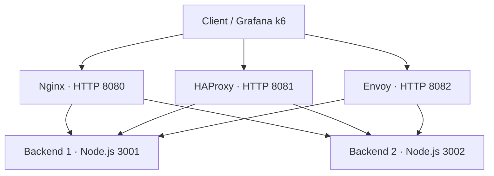

# Triển khai và đánh giá các hệ thống Load Balancer (Nginx, HAProxy, Envoy)

Đồ án xây dựng phòng thử nghiệm cân bằng tải cho tình huống nhiều sinh viên truy cập cổng đăng ký học phần cùng lúc. Mục tiêu là quan sát cách phân phối yêu cầu, chuyển tải khi backend gặp sự cố và so sánh hiệu năng của ba proxy trong cùng một workload.

Hệ thống sử dụng **Docker Desktop và Docker Compose** để chạy **Nginx, HAProxy, Envoy** và hai backend **Node.js/Express**. **Grafana k6** tạo tải, còn Dashboard Node.js trình bày kết quả. Backend mô phỏng phản hồi API và nhận diện máy chủ xử lý. Kết quả phản ánh điều kiện của lab Windows, cấu hình và tải đã đo. Hệ thống production có thể cho kết quả khác.

## Kiến trúc hệ thống

Client hoặc k6 chọn một proxy cho mỗi lượt. Ba proxy hoạt động độc lập, mỗi proxy có thể chuyển yêu cầu tới cả hai backend.



| Proxy | HTTP | HTTP/2 REST qua TLS | gRPC Unary qua TLS |
|---|---:|---:|---:|
| Nginx | 8080 | 8440 | 9440 |
| HAProxy | 8081 | 8441 | 9441 |
| Envoy | 8082 | 8442 | 9442 |

Bảng dùng cổng công bố trên máy chạy lab. Dịch vụ gRPC trên mỗi backend nghe cổng nội bộ `50051`. Xem [Docker Compose](docker-compose.yml) và [hướng dẫn HTTP/2, gRPC](docs/http2-grpc.md).

## Thuật toán cân bằng tải

| Thuật toán | Nginx | HAProxy | Envoy | Endpoint |
|---|---|---|---|---|
| Round Robin | Mặc định của upstream | `balance roundrobin` | `ROUND_ROBIN` | `/api` |
| Weighted Round Robin (3:1) | `weight=3` và `weight=1` | `balance roundrobin` với trọng số 3:1 | `ROUND_ROBIN` với trọng số endpoint 3:1 | `/api/wrr` |
| Least Connections / Least Request | `least_conn` | `balance leastconn` | `LeastRequest` | `/api/least` |
| IP Hash / Source-IP Affinity | `ip_hash` | `balance source` với consistent hash | `RING_HASH` với IP nguồn | `/api/iphash` |

- **Round Robin** chọn luân phiên giữa các backend khả dụng, phù hợp khi backend có năng lực tương đương.
- **Weighted Round Robin** chia lượt chọn theo trọng số. Tỷ lệ kỳ vọng của cấu hình lab là 75% cho Backend 1 và 25% cho Backend 2 khi cả hai khả dụng.
- **Least Connections / Least Request** xét tải đang xử lý. Nginx và HAProxy xét số kết nối hoạt động. Envoy chọn theo số yêu cầu đang xử lý trong tập endpoint được lấy mẫu khi trọng số bằng nhau.
- **IP Hash / Source-IP Affinity** dùng IP nguồn quan sát được để chọn đích. Ba proxy dùng cơ chế ánh xạ riêng. NAT có thể gom nhiều client vào cùng khóa và việc thay đổi tập backend có thể làm đổi ánh xạ.

**Benchmark chính thức sử dụng Round Robin.** Ba chính sách còn lại có endpoint riêng để quan sát trong Demo.

## Dashboard cục bộ

| Trang | Nội dung |
|---|---|
| Tổng quan đề tài | Bài toán, phạm vi lab và sơ đồ triển khai thực tế |
| Lý thuyết | 15 bài có ví dụ, sơ đồ, cấu hình và liên kết trực tiếp theo chủ đề |
| Demo hệ thống | Phân phối yêu cầu qua bốn thuật toán và tab Health Check & Failover |
| Benchmark | Chọn RUN/workload, xem bảng, biểu đồ, xếp hạng, đối chiếu từng cặp proxy và xuất CSV |
| Nhóm thực hiện | Thông tin nhóm và giảng viên hướng dẫn |

Giao diện hỗ trợ **VI/EN**, **Light/Dark** và bố cục đáp ứng. Dashboard đọc CPU/RAM của container proxy từ mẫu Docker Engine và chỉ so sánh khi mẫu tương thích. RUN đủ điều kiện có thể chuyển vào Trash và khôi phục. RUN chính thức và các RUN lịch sử được bảo vệ. Dashboard lắng nghe trên `127.0.0.1` và được dùng cục bộ.

## Phương pháp benchmark

| Workload | Phép thử |
|---|---|
| REST API | Gửi `GET /api` và kiểm tra HTTP 200 |
| Keep-Alive ON | Cho phép k6 tái sử dụng kết nối HTTP với proxy |
| Keep-Alive OFF | Tắt tái sử dụng kết nối phía k6 |
| HTTP/2 | Gọi REST qua TLS và kiểm tra phản hồi thực sự dùng HTTP/2 |
| gRPC Unary | Gọi `benchmark.GreeterService/SayHello`, kiểm tra trạng thái, payload và phản hồi từ cả hai backend |

RUN chính thức gồm **3 proxy × 5 workload**, chạy tuần tự với **10 VUs trong 30 giây mỗi lượt**. Hai kịch bản Keep-Alive nghỉ 50 ms mỗi vòng. Chỉ so sánh proxy trong cùng workload vì nhịp gửi, payload và đường xử lý có thể khác giữa các kịch bản.

k6 ghi tổng số request hoặc lượt gọi, **throughput** mỗi giây, **độ trễ trung bình**, **P95** và **tỷ lệ lỗi** theo quy tắc của workload. Docker Engine lấy mẫu CPU và RAM của **container proxy**, hiển thị trung bình và đỉnh mẫu khi có dữ liệu phù hợp. CPU dùng thang 100% mỗi lõi. Kết quả chịu ảnh hưởng của tài nguyên máy, tải nền, phiên bản container và số lần lặp. Các ví dụ trong Lý thuyết minh họa cơ chế, còn bảng dưới đây là kết quả đo đã lưu.

## Kết quả thực nghiệm

RUN chính thức `web-full-2026-11-15T14-13-23-595Z-106fae93` ghi nhận **15/15 lượt PASS**. Kết quả REST API trích từ dữ liệu k6 của RUN này, làm tròn ba chữ số thập phân.

| Proxy | Throughput (RPS) | Độ trễ TB (ms) | P95 (ms) | Tỷ lệ lỗi |
|---|---:|---:|---:|---:|
| Nginx | 5357.654 | 1.758 | 2.715 | 0% |
| HAProxy | 4805.848 | 1.974 | 2.929 | 0% |
| Envoy | 4797.552 | 1.987 | 2.799 | 0% |

Đây là **kết quả đo cục bộ đã xác minh**. Tệp gốc của RUN chính thức và mẫu CPU/RAM nằm trong `dashboard/results/`, được Git bỏ qua và không thể tải từ repository. Bản clone vẫn xem được các lượt lịch sử đã theo dõi trong [benchmark/results](benchmark/results). [Tổng hợp lịch sử](docs/chapter4-results.md) mô tả một RUN riêng.

## Cài đặt và chạy trên Windows PowerShell

Cần **Node.js 20 trở lên**, npm, Git và **Docker Desktop** đang chạy Linux containers với Docker Compose. Cài **Grafana k6** trong `PATH` nếu cần tạo tải. Xem Dashboard và kết quả có sẵn không cần chạy k6 hoặc FULL RUN.

### Chuẩn bị và khởi động lab

```powershell
git clone https://github.com/TranPhiHung1/load-balancer-benchmark.git
Set-Location load-balancer-benchmark
npm.cmd ci --prefix tools
node tools/generate-certs.cjs
docker compose config --quiet
docker compose up -d --build
docker compose ps
```

Backend cài dependency khi build image. Dashboard chỉ dùng module tích hợp của Node.js. Chứng chỉ tự ký được tạo trong `certs/` cho TLS của lab. Docker Desktop phải cấp cho tài khoản đang chạy Dashboard quyền truy cập Docker Engine nếu dùng giám sát CPU/RAM hay thao tác Health Check & Failover. Với socket hoặc named pipe khác mặc định, xem [hướng dẫn Dashboard](docs/DASHBOARD-GUIDE.md).

### Mở Dashboard và kiểm tra API

```powershell
$env:DASHBOARD_PORT = '5174'
npm.cmd start --prefix dashboard
```

Mở [http://127.0.0.1:5174](http://127.0.0.1:5174) trên máy đang chạy Dashboard. Trong một cửa sổ PowerShell khác, kiểm tra ba API và đọc trường `port` để nhận diện backend trả lời.

```powershell
Invoke-RestMethod http://127.0.0.1:8080/api
Invoke-RestMethod http://127.0.0.1:8081/api
Invoke-RestMethod http://127.0.0.1:8082/api
```

Chạy bộ kiểm thử Dashboard từ thư mục gốc với `npm.cmd test --prefix dashboard`. Các bài kiểm thử runner sử dụng fixture thay cho k6 thật.

### Dừng an toàn

Chờ tác vụ đang chạy kết thúc hoặc dùng nút dừng tương ứng. Nếu đang demo Failover, khôi phục backend trước khi đóng phiên. Nhấn **Ctrl+C** trong cửa sổ chạy Dashboard, rồi chạy các lệnh sau từ thư mục gốc.

```powershell
docker compose stop
docker compose ps -a
```

Lần sau dùng `docker compose up -d`, đặt lại `DASHBOARD_PORT=5174` trong PowerShell và khởi động Dashboard.

## Tài liệu dự án

- Cấu hình [Nginx](nginx/nginx.conf), [HAProxy](haproxy/haproxy.cfg) và [Envoy](envoy/envoy.yaml).
- [Hướng dẫn Dashboard](docs/DASHBOARD-GUIDE.md) và [lệnh Demo](docs/DEMO-COMMANDS.md).
- [Script và runner benchmark](benchmark), [công cụ kiểm tra](tools) và [ghi chú xác minh](docs/verification.md).
- [Triển khai HTTP/2, gRPC và giới hạn thực nghiệm](docs/http2-grpc.md).
- [Nguồn logo Đại học Đà Lạt](https://dlu.edu.vn/logo-truong-dai-hoc-da-lat/).

## Nhóm thực hiện

**Trường Đại học Đà Lạt · Khoa Công nghệ Thông tin · Lớp CTK47A**

| Sinh viên | MSSV |
|---|---|
| Trần Phi Hùng | 2312628 |
| Trần Minh Tiến | 2312773 |
| Phạm Văn Hiếu | 2312615 |

**Giảng viên hướng dẫn** — ThS. Nguyễn Văn Huy Dũng.
